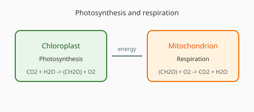

# 细胞呼吸与光合作用

## 1. 细胞呼吸

### 有氧呼吸

$C_6H_{12}O_6 + 6O_2 + 6H_2O \rightarrow 6CO_2 + 12H_2O + \text{能量}$

三个阶段：糖酵解（细胞质基质）、丙酮酸氧化与三羧酸循环（线粒体基质）、电子传递链（线粒体内膜）。

### 无氧呼吸

产物为酒精和 $CO_2$，或乳酸。释放能量少。

---

## 2. 光合作用

$6CO_2 + 12H_2O \xrightarrow{光} C_6H_{12}O_6 + 6O_2 + 6H_2O$

- 光反应：类囊体薄膜，水的光解、ATP 和 [H] 的生成
- 暗反应：叶绿体基质，CO₂ 固定与 $C_3$ 还原

---

[返回细胞生物首页](index.md) · [返回生物知识库](../index.md)
