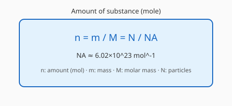

# 物质的量与化学计量

## 1. 物质的量

物质的量 $n$，单位摩尔（mol）。

阿伏加德罗常数 $N_A \approx 6.02 \times 10^{23}\ \mathrm{mol^{-1}}$

$$n = \dfrac{N}{N_A} = \dfrac{m}{M} = \dfrac{V}{V_m}$$

（气体在标准状况下 $V_m = 22.4\ \mathrm{L/mol}$）

---

## 2. 摩尔质量与气体摩尔体积

- 摩尔质量 $M$ 数值上等于相对分子（原子）质量
- 气体摩尔体积与温度、压强有关

---

## 3. 化学计量关系

根据化学方程式中的计量数关系进行计算。注意过量问题与纯度、产率。

---

[返回化学基础首页](index.md) · [返回化学知识库](../index.md)
