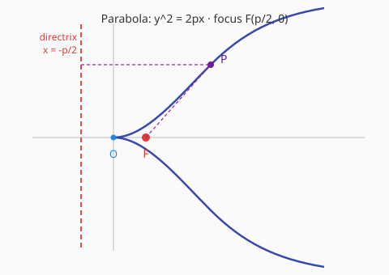

# 抛物线 Parabola

## 1. 定义

平面内到定点 $F$（焦点）的距离等于到定直线 $l$（准线）的距离的点的轨迹叫做**抛物线**。

---

## 2. 标准方程（四种形式）

设 $p > 0$（焦点到准线的距离）。

| 开口方向 | 标准方程 | 焦点 | 准线 |
|----------|----------|------|------|
| 向右 | $y^2 = 2px$ | $\left(\dfrac{p}{2}, 0\right)$ | $x = -\dfrac{p}{2}$ |
| 向左 | $y^2 = -2px$ | $\left(-\dfrac{p}{2}, 0\right)$ | $x = \dfrac{p}{2}$ |
| 向上 | $x^2 = 2py$ | $\left(0, \dfrac{p}{2}\right)$ | $y = -\dfrac{p}{2}$ |
| 向下 | $x^2 = -2py$ | $\left(0, -\dfrac{p}{2}\right)$ | $y = \dfrac{p}{2}$ |

最常用的是 $y^2 = 2px$（开口向右）。

---

## 3. 基本量

- 焦点到顶点的距离：$\dfrac{p}{2}$
- 离心率 $e = 1$（所有抛物线的离心率都是 $1$）
- 通径（过焦点且垂直于对称轴的弦）长为 $2p$

---

## 4. 几何性质

### 范围

- $y^2 = 2px$：$x \geq 0$
- $y^2 = -2px$：$x \leq 0$
- $x^2 = 2py$：$y \geq 0$
- $x^2 = -2py$：$y \leq 0$

### 对称性

关于对称轴对称（只有一条对称轴）。

### 顶点

所有标准方程的顶点都是原点 $(0,0)$。

---

## 5. 焦半径公式

设点 $P(x_0, y_0)$ 在抛物线 $y^2 = 2px$ 上，

$$|PF| = x_0 + \dfrac{p}{2}$$

（其他开口方向作相应调整）

---

## 6. 常用结论与性质

### 焦点弦性质

设抛物线 $y^2 = 2px$，过焦点的弦 $AB$，其中 $A(x_1,y_1)$、$B(x_2,y_2)$。

1. **弦长公式**：
   $$|AB| = \dfrac{2p}{\sin^2 \theta} \quad (\theta \text{ 为弦与 } x \text{ 轴夹角})$$
   或
   $$|AB| = x_1 + x_2 + p$$
2. 过焦点的弦中，通径最短。
3. 抛物线上一点到焦点的距离等于到准线的距离（定义本身）。

---

## 7. 参数方程

对于 $y^2 = 2px$：

$$\begin{cases} x = \dfrac{p}{2} t^2 \\ y = p t \end{cases}$$

其中 $t$ 为参数。

---

[返回圆锥曲线首页](index.md) · [返回数学知识库](../index.md)
