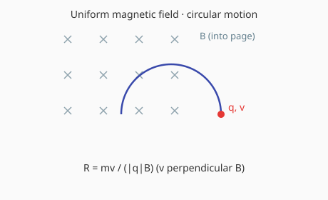

# 洛伦兹力

## 1. 洛伦兹力公式

$$F = qvB\sin\theta$$

方向：左手定则（四指指向正电荷运动方向）。

洛伦兹力始终与速度垂直，不做功。

---

## 2. 带电粒子在匀强磁场中的运动

- 速度与 $\vec{B}$ 平行：匀速直线运动
- 速度与 $\vec{B}$ 垂直：匀速圆周运动，半径 $R = \dfrac{mv}{qB}$，周期 $T = \dfrac{2\pi m}{qB}$
- 一般情况：螺旋运动

---

[返回电磁学首页](index.md) · [返回物理知识库](../index.md)
